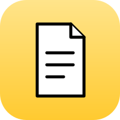
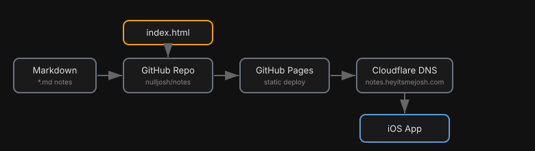

# notes

  [](https://github.com/nulljosh/notes)

My notes. Plain markdown in `notes/`, kept in git. Git is the sync and the backup. Open `notes/` as an Obsidian vault if you want a UI.

The public site (notes.jaybulb.com) was taken down 2026-08-30. There is no HTTP API.


## Notes

- `master.md`: current state. Every project and what ships next
- `ideas.md`, `app-scaling.md`: product ideas and scaling notes
- `pixelmator.md`: Pixelmator plus Claude AppleScript workflow
- `reminders.md`: synced from Apple Reminders, kept local (gitignored)

## Architecture



`pages/` holds static HTML renders of the notes, built by `scripts/simplify.sh`. The Claude memory graph moved into the `brain` repo (brain.jaybulb.com/graph). `ios/` is a WKWebView wrapper, unused since the site came down.

## Scripts

```bash
./scripts/sync-reminders.sh  # Apple Reminders → notes/reminders.md
./scripts/sync.sh            # notes → Obsidian vault → brain
./scripts/simplify.sh        # normalize structure + rebuild pages/
```

## License

MIT 2026, Joshua Trommel

## Whitepaper

[Technical whitepaper](WHITEPAPER.md)
